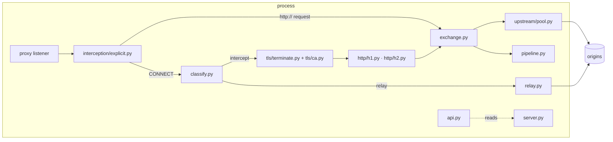

# Architecture Internals

How mitm-proxy works inside: for contributors, reviewers and AI assistants. User-facing behaviour belongs on the other pages.

## Overview

One asyncio process runs two listeners: the **proxy** (`proxy.port`) and the read-only **admin API** (`listen.port`, FastAPI under uvicorn). A client connection enters through an *interception source*, which yields the target the client wants. One decision function says whether that tunnel is intercepted or relayed raw. Intercepted traffic is decrypted with a leaf certificate from the CA, parsed by the HTTP/1.1 (h11) or HTTP/2 (h2) layer into protocol-neutral flows, run through the middleware pipeline, and sent on through a pool of verified upstream connections.

## Components

| Module | Responsibility |
|---|---|
| `mitm_proxy/__init__.py` | Package version |
| `mitm_proxy/config.py` | Settings and their precedence (`_FILE` > env > file > default) |
| `mitm_proxy/cli.py` | The `mitm-proxy` command (Typer) |
| `mitm_proxy/api.py` | The HTTP API (FastAPI): health, readiness, version |

| `mitm_proxy/service.py` | The process: proxy listener and admin API on one loop; ordered shutdown on SIGTERM |
| `mitm_proxy/server.py` | `ProxyServer`: the configuration snapshot, the listener, tunnel handling, status |
| `mitm_proxy/interception/base.py` | `InterceptedConnection` and the `InterceptionSource` seam (Phase 2 adds a transparent source) |
| `mitm_proxy/interception/explicit.py` | The explicit-proxy source: CONNECT and absolute-form requests, proxy authentication |
| `mitm_proxy/classify.py` | The one intercept-or-relay decision, and peeking the ClientHello |
| `mitm_proxy/scope.py` | The allowlist: host normalization and `*.suffix` matching |
| `mitm_proxy/relay.py` | Raw bidirectional relay with half-close and an idle timeout |
| `mitm_proxy/streams.py` | `ByteStream`: the one stream shape every layer uses |
| `mitm_proxy/tls/clienthello.py` | Parses SNI and ALPN from a ClientHello (pure function) |
| `mitm_proxy/tls/ca.py` | Root CA load/generate; leaf minting with one shared key; the LRU of server contexts |
| `mitm_proxy/tls/terminate.py` | TLS over memory BIOs, so peeked bytes can be replayed into the handshake |
| `mitm_proxy/tls/upstream.py` | The always-verifying upstream SSL contexts |
| `mitm_proxy/http/flow.py` | `Flow`, `Request`, `Response`, `ClientConn`, `ServerConn`, `FlowType` |
| `mitm_proxy/http/headers.py` | `Headers`: ordered, case-insensitive multimap |
| `mitm_proxy/http/body.py` | `BodyStream`, `BufferedBodyStream`, `PassthroughBody` |
| `mitm_proxy/http/normalize.py` | Header normalization; h2 pseudo-headers ⇄ h1 request line and Host |
| `mitm_proxy/http/framing.py` | Content-Length vs chunked, and the HEAD/1xx/204/304 rule |
| `mitm_proxy/http/messages.py` | What protocol layers hand the exchange: `IncomingRequest`, `Responder`, `UpstreamResponse` |
| `mitm_proxy/http/h1.py` | HTTP/1.1 on h11: client-facing server (incl. proxy mode) and upstream client |
| `mitm_proxy/http/h2.py` | HTTP/2 on h2: client-facing server and upstream client, flow control |
| `mitm_proxy/exchange.py` | One request: flow, middleware, framing, upstream, response; WebSocket hand-off |
| `mitm_proxy/pipeline.py` | The middleware API (`Middleware`, `Action`) and the runner |
| `mitm_proxy/upstream/pool.py` | The connection pool and the TCP/TLS connector |
| `mitm_proxy/auth.py` | Basic proxy authentication |
| `mitm_proxy/metrics.py` | Prometheus text exposition |
| `mitm_proxy/errors.py` | Exception types |

## Data flow

Following `curl --proxy … https://example.org/` with `example.org` listed:

1. **Accept.** `service.py` accepted the TCP connection; `ProxyServer` hands it to `ExplicitProxySource`, which reads HTTP/1.1 in proxy mode and checks `Proxy-Authorization` if `proxy.auth` is set (407 otherwise).
2. **CONNECT.** The source builds an `InterceptedConnection` (stream, target, `accept`/`reject`) and calls `ProxyServer.handle_tunnel`. It reads the configuration *snapshot* current now and keeps it for the whole connection.
3. **Decide.** `classify.decide` checks scope (unlisted: connect to the origin, answer 200 or 502/504, relay raw). Listed: answer 200, peek the ClientHello (`proxy.peek_timeout_ms`), decide again on the bytes and the SNI.
4. **TLS.** `CertificateAuthority.server_context(host)` returns a cached context, or mints a leaf (one signature: the leaf key is shared). `TLSStream` replays the peeked bytes into an `SSLObject` and completes the handshake; ALPN picks `H2Server` or `H1Server`.
5. **Flow.** The protocol layer turns each request into an `IncomingRequest` (normalized headers, a body iterator) and a `Responder`. `exchange.handle` creates the `Flow`, starts the pipeline (`applies_to` decided once), buffers bodies only if middleware applies (up to `body.max_buffer_bytes`, else passthrough), runs `on_request` and the chunk hooks.
6. **Upstream.** The pool returns a connection to `(host, port, SNI)`: an HTTP/2 one is shared by concurrent flows, an HTTP/1.1 one is leased to one request at a time. A reused HTTP/1.1 connection that fails before any response byte is retried once on a new connection, for idempotent requests with a replayable body.
7. **Back.** The response head becomes `flow.response`; `on_response` and the response chunk hooks run; `framing.plan` picks the framing; the responder writes it.

**Timings:** `Flow.timings` is stamped along the way on the `time.monotonic()` clock: by `exchange.py` at each stage (the request body read, the pool lease, the request sent upstream through a wrapper on the body iterator, the response head, the end), and by `FlowPipeline` around every hook it awaits (per middleware). That's a few clock reads per flow.

**Access log:** `exchange.handle` wraps the client's request body in a byte counter and the client's `Responder` in a `_Recorder` (status sent, body bytes, finished or not). The exchange marks the path it took (origin, local, denied, error), and the `finally` that stamps `complete` writes the line: a synchronous log call, so it's also written when the task is cancelled. An unfinished response is `aborted`. Relayed tunnels are logged from `ProxyServer._relay`, using the counts `relay()` returns.

**End of a flow:** the same `finally` sets `flow.outcome`, writes the access-log line, then awaits `FlowPipeline.run_done()` (`on_done` for each middleware that applied). It runs when the task is cancelled too: an HTTP/2 stream reset, or shutdown after the grace period. That's why `H2Server` awaits its cancelled stream tasks before returning, so shutdown waits for their `on_done` (each bounded by the hook timeout). With `proxy.server_timing` on, `exchange.server_timing` turns them into a `Server-Timing` field, added after the response hooks and the framing headers, just before `responder.start` (and in `send_simple` for denies and proxy errors).

**State** is in memory only: the snapshot, the CA's LRU of server contexts, the pool. The root CA is the only thing on disk (`<state_dir>/ca/`); the shared leaf key sits encrypted in a private temporary directory while the process runs.

**Failure:** middleware errors are contained per flow (the middleware is skipped, logged and counted); upstream errors become 502/504 responses; a broken client connection ends only that connection. HTTP/2 stream errors reset one stream, not the connection.

**Backpressure:** every write awaits `drain()`; HTTP/2 DATA is acknowledged only as it's consumed; middleware hooks are awaited in line, never as background tasks.

## Design decisions

Why things are the way they are is recorded in [docs/design/](https://github.com/metalayerlab/mitm-proxy/tree/main/docs/design). Rejected ideas and the reasons are in [TODO.md](https://github.com/metalayerlab/mitm-proxy/blob/main/TODO.md) under "Decided against".

From [0001: Initial design](https://github.com/metalayerlab/mitm-proxy/blob/main/docs/design/0001-initial-design.md), unless noted:

- **Allowlist, fail closed:** only listed hosts are intercepted; scope is checked before peeking, and an unlisted SNI is relayed.
- **The `InterceptionSource` seam:** nothing after it knows how a connection arrived, so transparent interception is one new source.
- **`Flow` per request/stream, protocol-neutral:** both legs negotiate their own protocol; middleware never sees frames.
- **Chunk-capable hooks from the start, buffered implementation for now.**
- **Framing from registration, not from what a hook did;** HEAD/1xx/204/304 never framed.
- **Middleware failure fails open,** with the middleware's name in the log.
- **Upstream TLS is always verified;** extra CAs are added, never substituted.
- **Middleware by name from a local registry, an immutable config snapshot, `/v1/status` and `/metrics`:** from [0002: Control-plane management](https://github.com/metalayerlab/mitm-proxy/blob/main/docs/design/0002-control-plane-management.md) (Proposed; only these parts are built).
