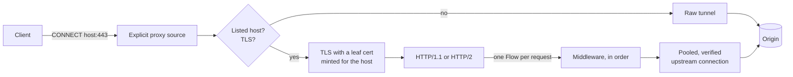

# Introduction

## What it is

mitm-proxy is a man-in-the-middle HTTP(S) proxy for labs: for developers and testers who need to see exactly what a client and a server say to each other, and to change it in flight, without touching either end.

Clients are configured to use it as their proxy (an *explicit* proxy) and trust its own root CA. For the hosts you list, it decrypts the traffic, hands each request and response to your middleware as a protocol-neutral `Flow`, and sends it on. You write middleware in Python against that one object, whatever protocol each side speaks.

It deliberately does **not** try to be:

- a security gateway: when a middleware fails, the traffic passes through without it (fail open), because in a lab a buggy experiment shouldn't take traffic down;
- an intercept-everything tool: it intercepts only the hosts you list, and tunnels the rest untouched;
- a recorder or viewer: it keeps no history of flows and has no UI (yet);
- a transparent proxy: clients must be configured to use it (transparent interception is planned).

## How it works

1. A client sends `CONNECT example.org:443`. If `example.org` isn't on the allowlist (`intercept.hosts`), the proxy connects and relays bytes both ways without looking: no decryption, no middleware.
2. If it is listed, the proxy reads the client's TLS ClientHello. Traffic that isn't TLS, or asks for an unlisted name, is relayed raw too.
3. Otherwise the proxy presents a certificate for the host, signed by its root CA (minted on the spot, then cached), and terminates TLS. The client and proxy agree HTTP/2 or HTTP/1.1.
4. Each request becomes a `Flow`. The middleware in `middleware.chain` sees it in order: it can read and rewrite headers and bodies, answer it itself, or refuse it.
5. The proxy sends the request to the origin over a pooled connection. It always verifies the origin's certificate, and agrees HTTP/2 or HTTP/1.1 with it separately, so an HTTP/2 client can talk to an HTTP/1.1 origin and the other way round.
6. The response comes back through the middleware to the client.

Plain `http://` requests go the same way, without the TLS. WebSocket upgrades are passed through as raw bytes once the upgrade succeeds. The details are in [Architecture Internals](Architecture-Internals).

## When not to use it

- **To enforce anything.** A failing or hanging middleware is skipped and the traffic flows on. Don't rely on it to block traffic.
- **For apps that pin certificates.** They reject any certificate but the real one: leave their hosts off the allowlist and they keep working, uninspected.
- **For HTTP/3 (QUIC).** It's UDP, and doesn't go through an HTTP proxy.
- **For very large bodies through middleware.** Bodies are buffered for middleware up to `body.max_buffer_bytes` (64 MiB); bigger ones are streamed through *uninspected*.
- **At high throughput.** It's one Python process, sized for hundreds of requests a minute on a lab network.
- **To record, replay or browse traffic.** It keeps no flow history; [mitmproxy](https://mitmproxy.org/) has a UI, recording and replay.
- **Without client configuration.** Transparent interception (redirecting traffic at the OS level) is planned, not built.
